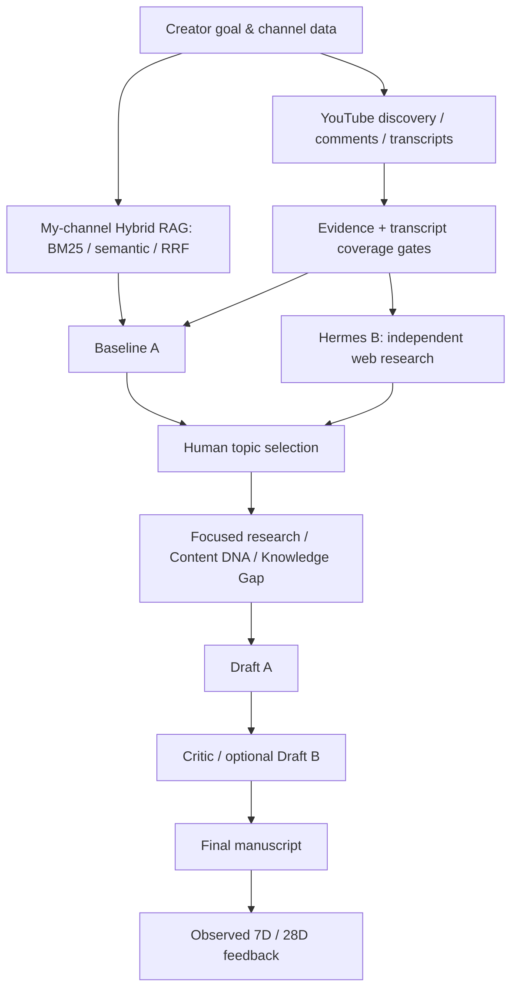

# Creator Decision Intelligence
### Evidence-first YouTube Research & Script Workflow

**Applied AI · Retrieval-Augmented Generation · Decision Support · Local-first Research Prototype**

> **좋은 주제를 감으로 선택하는 대신, 어떤 근거로 제작해야 하는지 판단한다.**  
> 실제 영어교육 유튜브 채널을 운영하며 겪은 반복적 조사·판단 비용을 줄이기 위해 개발한 개인 AI 크리에이터 컨설턴트입니다.

## 01. 문제 정의

유튜브 영상을 하나 제작하려면 경쟁 영상과 시장 수요를 조사하고, 조회수·댓글·자막을 읽고, 내 채널의 기존 설명과 비교하며, 대본까지 완성해야 합니다.

일반적인 AI 브레인스토밍은 **그럴듯한 추천**을 제시하지만, **그 추천이 관측 자료에 연결되는지** 별도 검증이 필요합니다.

**프로젝트 목표:** 시장 조사 → 독립 추천 비교 → 근거 감사 → 선택 주제의 심층 조사 → 대본 A/B → 제작자 최종 확정을 하나의 화면 흐름으로 연결하는 것.

## 02. 핵심 워크플로

| 단계 | 핵심 구현 | 사용자에게 제공하는 가치 |
| --- | --- | --- |
| **Discover** | YouTube Data API, 채널 기준 Outlier / Recent 신호 | 제작 후보 발견 |
| **Compare** | 채널 분석·Hybrid RAG 기반 A vs 별도 웹 조사 Hermes B | 근거가 다른 추천 비교 |
| **Research** | 댓글·Transcript, Content DNA, Knowledge/Format Gap | 설명 소재 및 차별점 도출 |
| **Write** | 구조 설계 → Draft A → Critic → 선택적 Draft B | 촬영 가능한 원고 |
| **Decide & Learn** | 사용자 선택, 7/28일 실제 관측 기록 | 추후 가설 재검토 |

**A/B 주의:** 모델 품질을 동일 조건에서 실험하는 것이 아니라 서로 다른 자료 접근 방식을 가진 **추천 워크플로의 비교**입니다. 링크 확보만으로 시장 수요나 조회수 성공이 증명되지 않습니다.

## 03. 기술 아키텍처

| 영역 | 기술 |
| --- | --- |
| UI | Python, Streamlit, HTML/CSS |
| 데이터 수집 | YouTube Data API, public transcripts, comments, manual Studio CSV |
| 검색/RAG | BM25, OpenAI embeddings, Reciprocal Rank Fusion |
| LLM | OpenAI Responses API, structured outputs & validation |
| 에이전트 | Hermes, local adapter, Docker isolation |
| 기록 | Persistent local cache, evidence provenance, decision logs |
| 검증 | Unit tests, mocked integrations, coverage/error checks |

## 04. 중요한 기술적 선택

**Evidence-first:** 조회수가 높다는 이유만으로 인기 주제라고 단정하지 않습니다. 채널 기준 Outlier, 업로드 경과 시간, 표본 크기, 출처 연결 상태를 구분합니다.

**Transcript Coverage Gate:** 충분한 자막이 없으면 상세 분석을 정상 완료한 것으로 가장하지 않습니다.

**Hybrid Retrieval:** 내 채널의 과거 설명과 중복되는지 키워드 BM25 및 semantic retrieval을 결합해 확인합니다.

**Human-in-the-loop:** 추천 순위는 결론이 아닙니다. 제작자가 선택하고, 이후 관측값이 쌓이면 판단을 재검토합니다.

## 05. 시행착오와 한계

| 문제 | 대응 / 현재 상태 |
| --- | --- |
| YouTube API 검색 quota 소진 | 캐시·기존 영상 ID 재사용 방향; 신규 탐색은 여전히 한도 영향을 받음 |
| 자막 접근 차단 및 누락 | 로컬 캐시와 Coverage Gate, 실패 시 명시적 중단 |
| LLM API 429, 크레딧 부족 | 실패 원인을 구분해 안내; 실제 이용 요금은 사용자 계정 부담 |
| Hermes 추천과 근거 URL 불일치 | 링크 검증 및 재연결 로직; 관측 링크≠수요 검증 |
| UI 정보 과밀 | 결론을 먼저 보여주고 상세 증거는 펼쳐보기로 분리 |
| 버전·상태 재현성 | 앱 코드와 외부 사용자 데이터/캐시 분리, 오프라인 검사 |

**검증 범위:** 오프라인 테스트를 통과한 이력이 있으나, 모든 Windows / Docker / 외부 API 조합의 종단 간 성공이나 조회수 개선 효과가 입증된 것은 아닙니다.

## 06. 데모 — API 키 없이 보기

**[설치 없는 데모 페이지 열기](demo.html)** · [시연 설명](docs/DEMO_GUIDE.md)

GitHub에서 `demo.html` 파일을 다운로드하여 브라우저로 열면 **주제 발견 → 비교 → 조사 → 대본 A/B → 최종 선택** 흐름을 가상 데이터로 체험할 수 있습니다.

- 모든 데모 내용은 **합성 데이터**입니다. 실제 채널 성과나 AI 분석 결과가 아닙니다.
- 데모에는 **API 호출, 인증키, 유료 크레딧 사용이 없습니다.**
- **시연 영상:** 아직 등록되지 않았습니다. 완성된 영상은 이 위치에 추가할 계획입니다.

## 07. 공개 범위와 보안

이 저장소는 **포트폴리오 소개 + 안전한 체험 자료**입니다. 실제 로컬 엔진의 전체 소스는 별도 저장소로 관리합니다. 비밀 API 키, `.env`, 개인 Studio 지표, 캐시 및 비공개 대본은 공개하지 않습니다.

실제 엔진을 실행하는 개발자는 **자신의 키**를 사용합니다. 이 저장소를 열거나 데모를 사용하는 것만으로 프로젝트 소유자의 API 크레딧이 소비되지 않습니다.

---

Creator Decision Intelligence · Personal Applied AI Project · 2026-11-01
