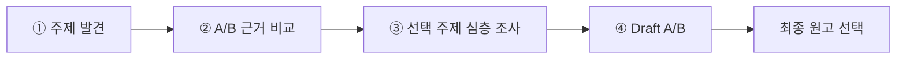
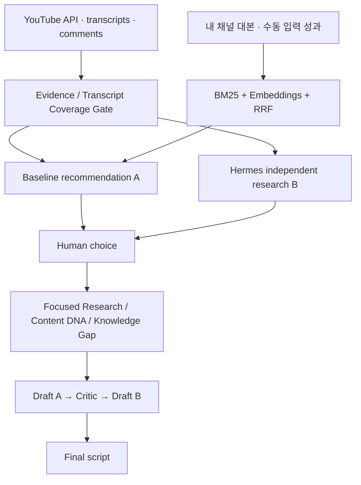

# Creator Decision Intelligence

**Evidence-first YouTube Content Research & Script Development**

> **다음 영상을 무엇으로 만들지, 감이 아니라 근거로 결정하는 AI 콘텐츠 컨설턴트.**

실제 영어교육 YouTube 채널을 운영하며 발생한 **시장 조사 → 주제 비교 → 심층 리서치 → 대본 완성**의 반복 작업을 하나의 제품으로 연결한 개인 프로젝트입니다.

### [▶ 웹 데모 직접 체험하기](https://jdabeen.github.io/creator-decision-intelligence-demo/)

**[데모 시연 영상 보기](https://github.com/user-attachments/assets/d79eaee2-9893-4e34-bd19-6b4d91ca16f0)**

데모는 **실제 프로그램의 의사결정 및 데이터 처리 흐름에 최대한 가깝게 설계한 클릭형 시뮬레이션**입니다. 단계와 사용자 선택 구조를 재현하되, 개인정보 보호와 비용 방지를 위해 **실제 검색·자막·LLM 호출 대신 예시 데이터와 미리 작성된 결과**를 사용합니다.

---

## Problem — 다음 콘텐츠를 결정하는 데 드는 비용

좋아 보이는 주제 하나를 고르려면 경쟁 채널의 영상 수집, 조회 성과 비교, 자막·댓글 분석, 내 채널에서 이미 설명한 내용과의 중복 검토, 구조 설계까지 반복해야 합니다. 단순히 LLM에 주제를 추천해 달라고 하면 그럴듯한 답을 받을 수 있지만 **추천이 실제 관측 자료와 연결되는지**는 별도의 문제입니다.

**해결 목표:** 시장에 존재하는 기회와 채널의 기존 자산을 비교하고, 제작자가 근거를 확인한 뒤 영상 방향과 원고를 결정할 수 있도록 합니다.

## Product Flow

| 단계 | 실제 프로그램의 처리 |
| --- | --- |
| **주제 발견** | YouTube Data API·채널 기준 Outlier·최근 반응 신호로 후보 탐색 |
| **A/B 비교** | 시장·내 채널 RAG 기반 **A**와 별도 웹 조사 기반 **Hermes B**의 추천 및 근거 비교 |
| **심층 조사** | Transcript·댓글·Content DNA·Explanation Atom·Knowledge Gap·기존 콘텐츠 중복 분석 |
| **대본 제작** | Structure → Draft A → Critic → 선택적 Draft B → 제작자 최종 확정 |
| **피드백** | 선택 기록과 발행 후 7·28일 실제 성과를 다음 의사결정의 참고 자료로 누적하는 구조 |

A/B는 동일 조건의 모델 성능 실험이 아니라 **서로 다른 조사 방식에 따른 추천 비교**입니다.

## Technical Architecture

| Layer | Stack |
| --- | --- |
| Application | Python, Streamlit, HTML/CSS |
| Market evidence | YouTube Data API, transcript, comments |
| Retrieval | BM25, semantic embeddings, Reciprocal Rank Fusion |
| AI orchestration | OpenAI Responses API, structured output validation, Hermes |
| Data integrity | Transcript Coverage Gate, evidence-to-topic linkage, persistent cache |

## Engineering Decisions & Lessons

**1. 단순 조회수 추천의 편향** — 대형 채널의 기본 조회 성과가 추천을 지배하는 문제를 확인하고 Channel Outlier·최근성·표본 크기를 분리했습니다.

**2. 자막 수집 실패** — 클라우드 IP 차단과 캐시 소실을 경험하며 로컬 수집·영속 캐시·Transcript Coverage Gate의 필요성을 확인했습니다.

**3. AI 추천의 출처 불일치** — Hermes 응답의 전략 경로 누락과 근거 URL 불일치로 중단되는 문제에 대해 정규화·재검증 및 진단 기록을 도입했습니다.

**4. API 비용과 운영 안정성** — YouTube 검색 quota 및 OpenAI API 크레딧 부족이 실제 조사에 미치는 영향을 확인하고 오류와 근거 부족을 구분했습니다.

**5. 정보 과밀 UI** — 내부 진단 정보를 한 화면에 과도하게 노출한 설계를 개선해, 판단과 다음 행동을 먼저 보여주고 상세 데이터는 펼쳐 보도록 했습니다.

**[개발 과정·실제 오류·기술적 판단 자세히 보기](docs/ENGINEERING_CASE_STUDY.md)**

## Validation & Scope

이 프로젝트는 실제 제작 작업에 사용한 **로컬 중심 연구용 프로토타입**입니다. 오프라인 테스트 및 실제 일부 작업 흐름을 거쳤지만, 외부 API를 포함한 모든 환경의 완전한 안정성이나 영상 성과 향상은 검증되지 않았습니다. 데모는 실제 파이프라인의 **단계와 의사결정 UX를 재현**하며, 실측 결과 또는 라이브 AI 동작의 증거로 제시하지 않습니다.
